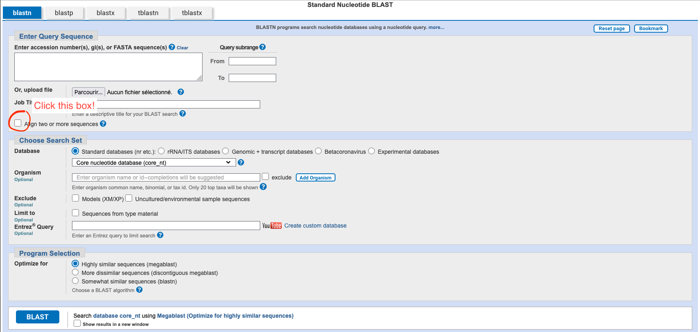

# Exercises for SIB SARS-CoV-2 workshop
These exercises can get a bit tricky, so please ask if you're stuck.
## Find and explore SARS-CoV-2 sequences
1. Go to the Genbank [https://ncbi.nlm.nih.gov/nuccore](https://ncbi.nlm.nih.gov/nuccore) and search for the original Wuhan sequence (generally considered the reference). This is the accession number: **NC_045512.2** 
2. In a new tab open one of the first complete sequences for the Alpha variant. This is the accession number: **MZ344997.1**
3. And finally, in another tab open the early Omicron sequence from the first example. Accession number: **OL672836.1**
4. Look at the information that is given to you for each sequence. What sort of information can you see? Think about this for 2-3 minutes.
5. Which country is each sequence from?
6. Can you find the **amino acid** sequence of the S (Spike) protein for each example? (Try using CMD+F or CTRL+F)

## Find mutations by aligning sequences
1. Go to [https://blast.ncbi.nlm.nih.gov](https://blast.ncbi.nlm.nih.gov) to run the so-called Basic Local Alignment Search Tool. Select Nucleotide BLAST.
2. Click the box that says "Align two or more sequences"
3. Input the accession number of our reference sequence into the first box (Query sequence) and input the accession number of our Alpha sequence into the bottom box (Subject sequence), then click BLAST. Remember the accession numbers are given to you in the first exercise.
4. Look at the pairwise alignment with the reference and look at the number of mutations you can see. How many are there between the reference and Alpha? There is an easy way and a time-consuming way. (Select the alignment view: pairwise with dots for identities to make it easier)

## What mutations change the translated protein?
Translate the following DNA sequences into the corresponding amino acid sequence. Using the genetic code wheel.  

| Variant | DNA sequence |
| ----------- | ----------- |
| Reference | CAA TCA TAT GGT TTC CAA CCC ACT AAT GGT GTT GGT TAC |
| Omicron | CGA TCA TAT AGT TTC CGA CCC ACT TAT GGT GTT GGT CAC |

1. How many mutations lead to a change in the amino acid sequence?
2. Can you think of a mutation that would have no effect on the translated amino acid? For example GTT -> XXX would still be Valine?
3. Double check your answers using an automatic translation tool like [https://stothardresearch.ca/sequence-manipulation-suite/#tool=translate](https://stothardresearch.ca/sequence-manipulation-suite/#tool=translate)  
**Careful**, you need to add a FASTA header before each sequence. It look something like this: >name_of_file

## Let's have a closer look at the Spike protein
1. Go to [https://www.uniprot.org/align](https://www.uniprot.org/align) and copy the amino acid sequences for the spike proteins of the reference, alpha, and omicron variant into the input box. (We found these in exercise 1)  
**Careful**, you need to add a FASTA header before each sequence. It look something like this: >name_of_file
2. Look at the output and count how many amino acid changes Alpha and Omicron have in common.
4. Head to [https://viralzone.expasy.org/9556](https://viralzone.expasy.org/9556) and look at the 3D model of the spike protein. Clicking on the texts and variant names on the right of the visualization highlights different areas of the 3D model. Can you find some of the mutations you identified earlier? (Our Omicron sequence corresponds to Omicron BA.1)

## Nextclade, a tool that does it all
1. Go to [https://clades.nextstrain.org/](https://clades.nextstrain.org/) and input each full nucleotide sequence we worked with before. Then click run. (To get the clean nucleotide sequence, click on FASTA at the top of the sequence page on Genbank)
2. What kind of information is Nexclade giving you? Explore the page a bit and see what you can find.
3. Now let's explore a Swiss sequence from this year. Go to [https://spsp.sib.swiss/](https://spsp.sib.swiss/) and select the sars-cov-2 option.
4. Order the samples by isolation date and find the most recently isolated sample.
5. Scroll all the way to the right and find the "ENA sequence id identifier" and copy it for this sample.
6. Find the corresponding FASTA nucleotide sequence on [Genbank](https://ncbi.nlm.nih.gov/nuccore).
7. Copy the sequence and add it to your existing Nextclade analysis. (Click on the "start" tab at the top)
8. What can you tell me about this sequence? What variant is it? How many mutations does it have compared to the reference sequence?

## Resources
- [https://lightofevolution.org/en/hunt-for-variants/](https://lightofevolution.org/en/hunt-for-variants/)
- [https://viralzone.expasy.org/9056](https://viralzone.expasy.org/9056)
- [https://pdb101.rcsb.org/motm/246](https://pdb101.rcsb.org/motm/246)
- [https://journals.asm.org/doi/full/10.1128/mra.01161-21](https://journals.asm.org/doi/full/10.1128/mra.01161-21)
- [https://www.rcsb.org/news/feature/5e74d55d2d410731e9944f52](https://www.rcsb.org/news/feature/5e74d55d2d410731e9944f52)
- [https://media.hhmi.org/biointeractive/click/covid/index.html](https://media.hhmi.org/biointeractive/click/covid/index.html)
- [https://covariants.org/](https://covariants.org/)
- [https://nextstrain.org/ncov/open/global/6m](https://nextstrain.org/ncov/open/global/6m)
- 3D printed model [https://insidecorona.net/update-how-to-make-your-own-3d-printed-coronavirus-model-version-2/](https://insidecorona.net/update-how-to-make-your-own-3d-printed-coronavirus-model-version-2/)